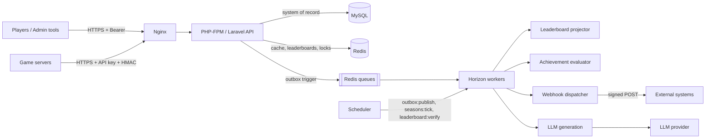
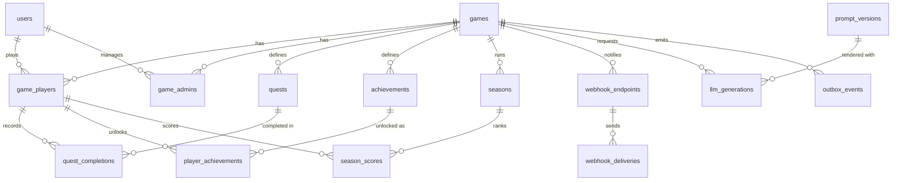

# Architecture

## Components



## Data model (ERD)



## Completing a quest

```mermaid
sequenceDiagram
    participant C as Client
    participant API as Laravel API
    participant DB as MySQL
    participant Q as Queue
    participant W as Worker
    participant R as Redis
    C->>API: POST /complete (Idempotency-Key)
    API->>R: lock key / look up stored response
    API->>DB: BEGIN; SELECT player FOR UPDATE
    API->>API: validate, cooldown, RiskScorer, XpCalculator
    API->>DB: INSERT completion; UPDATE xp/level; season points; INSERT outbox_events; COMMIT
    API-->>C: 201 {xp_awarded, player, level_up}
    API--)Q: PublishOutboxJob (best effort)
    Q->>W: publish pending outbox rows
    W->>R: ZINCRBY all / weekly / season (dedup by event id)
    W->>DB: evaluate achievements (unique insert) → new outbox rows
    W->>W: fan-out webhooks (signed, retried)
```

## AI quest generation

```mermaid
sequenceDiagram
    participant A as Game admin
    participant API as Laravel API
    participant DB as MySQL
    participant W as LLM worker
    participant L as LLM provider
    A->>API: POST /quests/generate {theme, difficulty, count}
    API->>DB: check monthly token quota (429 if exceeded)
    API->>DB: INSERT llm_generations (queued)
    API-->>A: 202 + Location
    W->>DB: load active prompt_version
    W->>L: system prompt + <input>{json}</input>
    L-->>W: JSON
    W->>W: schema validation (retry once with correction)
    W->>W: moderation
    W->>DB: INSERT quests as drafts (is_active=false, source=ai); record tokens + cost
    A->>API: GET /generations/{id} → review → POST /quests/{id}/publish
```

## Layering

`Controller (thin) → FormRequest → Action / domain service → Model`

| Folder | Contents |
|---|---|
| `app/Domain/Quests` | `CompleteQuest`, `ReviewCompletion`, DTOs |
| `app/Domain/Progression` | `XpCalculator`, `LevelCurve` |
| `app/Domain/AntiCheat` | `RiskScorer`, rules, `RequestSigner` (HMAC) |
| `app/Domain/Achievements` | `AchievementEvaluator` (JSON rules) |
| `app/Domain/Seasons` | `SeasonManager` (activate, close + snapshot, auto-renew) |
| `app/Domain/Leaderboard` | `RedisLeaderboard` (project, read, rebuild, verify) |
| `app/Domain/Outbox` | `Outbox`, `OutboxPublisher` |
| `app/Domain/Llm` | `LlmClient`, providers, `PromptBuilder`, `QuestSchema`, `Moderation`, `QuestGenerator` |
| `app/Domain/Webhooks` | `WebhookDispatcher`, `UrlGuard` (SSRF) |
| `app/Support` | tenancy, idempotency, metrics, audit logger, problem exceptions |

## Scaling notes
- `quest_completions` is the growing table. Indexes cover the hot paths and leaderboards never read it on the
  request path. Planned: archive rows older than N months to cold storage, or range-partition by `completed_at`
  (MySQL requires the partition column in every unique key, so the unique indexes would need to include it).
- PHP-FPM, Horizon and the scheduler are stateless and scale horizontally (run one scheduler).
